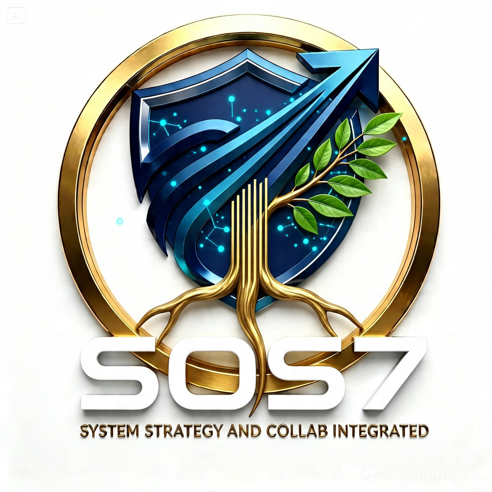

  
  
  <h1>SOS7: Spesialis Otomatisasi & Data</h1>
  
Infrastruktur digital otonom berbasis AI, Python, dan Node.js.

  
  <a href="https://sos7.my.id" style="display: inline-block; background: #25D366; color: white; padding: 12px 25px; text-decoration: none; border-radius: 8px; font-weight: bold; margin-top: 15px;">Kunjungi Website Resmi</a>

 

## 🏛️ Arsitektur Inti

SOS7 dibangun dengan pembagian tugas yang jelas untuk performa maksimal:

- ✅ **Pipa Data:** PostgreSQL, Hasura GraphQL, dan Intel RSS Scraper.
- ✅ **AI Orchestrator:** Gemini AI, DeepSeek AI, dan 38+ Fallback API.
- ✅ **Automation Engine:** Telegram Bot Engine, Auto-Poster System, dan Cron Jobs.
- ✅ **Keamanan:** Rate Limiter, Firewall, dan real-time Diagnostic Suite.

 

## 🎯 18 Layanan yang Tersedia

Kami menyediakan solusi lengkap yang terbagi dalam 4 paket utama:

### 1. 🤖 AI-Assisted (Layanan 1-7)
- Telegram Bot Auto-Poster & Tracker
- AI System Audit & Gap Analysis
- Social Media Auto-Poster & Scheduler
- Custom Data Scraper (OSINT)
- Web Scraping & Auto-Report Dashboard
- Auto-Backup & Server Monitoring
- AI Prompt Engineering & Workflow Setup

### 2. 📊 Data Analyst (Layanan 8-11)
- Audit & Pembersihan Data (Data Cleaning)
- Pembuatan Dashboard Interaktif (Looker/Power BI)
- Laporan Performa Bisnis
- Konversi & Migrasi Data Sistem

### 3. ⚙️ Data Engineer (Layanan 12-16)
- ETL Sederhana (Scraping ke Database)
- Integrasi API Antar Aplikasi
- Optimalisasi Query SQL
- Setup Database & Data Warehouse
- AI-Assisted Data Pipeline & Report

### 4. 🚀 Kapabilitas Ekstra (Layanan 17-18)
- Custom Backend & Automation Scripting
- Social Media Content Automation

 

## 📈 Bukti Kinerja (Proof of Work)

Berikut adalah bukti visual bahwa sistem SOS7 berjalan dan teruji:

### 1. Bot Auto-Poster (Berjalan 24/7)

*Bot Telegram SOS7 secara otomatis memposting produk afiliasi secara terjadwal.*

### 2. Diagnostic Suite (Server Monitoring)

*Sistem pemantauan kesehatan server (RAM, Disk, PM2) dengan skor 90+.*

### 3. AI Receptionist (Web Interaktif)

*Bot AI di web sos7.my.id yang menjawab pertanyaan klien secara otomatis.*

---

<i>Dibangun dengan ❤️ untuk Indonesia.</i>

